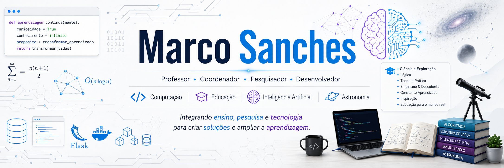

  

 
# Olá, seja bem-vindo ao meu perfil GitHub 👋 

### 👨‍🏫 Sobre mim
Sou professor e pesquisador nas áreas de **Computação e Educação**, com atuação no Ensino Superior em cursos de **Ciência da Computação e Análise e Desenvolvimento de Sistemas**.

Minha trajetória profissional integra ensino, pesquisa e desenvolvimento tecnológico, com interesse especial na aplicação da Computação e das Tecnologias Digitais em contextos educacionais.

Desenvolvo estudos e projetos relacionados à **Inteligência Artificial aplicada ao Ensino, Pensamento Computacional, Tecnologias Digitais, Ensino de Astronomia e desenvolvimento de soluções computacionais voltadas à Educação.**

Também possuo experiência de longa duração na Educação Básica, especialmente no Ensino de Física, área em que atuei por 27 anos.
 
### 🎓 Experiência
Atuo no Ensino Superior em disciplinas relacionadas à formação em Computação, entre elas:
- 💻 Algoritmos e Pensamento Computacional
- 🧠 Lógica de Programação
- 👨‍💻 Programação
- ⚙️ Engenharia de Software
- 🗃️ Banco de Dados
- 🌐 Desenvolvimento de Sistemas
- 📚 Projetos Interdisciplinares
- 🔬 Trabalho de Graduação Interdisciplinar – TGI
- 🧪 Iniciação Científica e orientação de projetos acadêmicos

Além da docência, atuo em atividades de coordenação acadêmica, orientação de estudantes e desenvolvimento de projetos educacionais e tecnológicos.

### 📊 Meu GitHub

 
<a href="https://github.com/msanches">
  
  
 

  
### 🛠️ Tecnologias e Ferramentas

 

### 🌐 Contatos

   

<!--
**msanches/msanches** is a ✨ _special_ ✨ repository because its `README.md` (this file) appears on your GitHub profile.

Here are some ideas to get you started:

- 🔭 I’m currently working on ...
- 🌱 I’m currently learning ...
- 👯 I’m looking to collaborate on ...
- 🤔 I’m looking for help with ...
- 💬 Ask me about ...
- 📫 How to reach me: ...
- 😄 Pronouns: ...
- ⚡ Fun fact: ...
-->
### PacMan
<picture>
  <source media="(prefers-color-scheme: dark)" srcset="https://raw.githubusercontent.com/msanches/msanches/output/pacman-contribution-graph-dark.svg">
  <source media="(prefers-color-scheme: light)" srcset="https://raw.githubusercontent.com/msanches/msanches/output/pacman-contribution-graph.svg">
  
</picture>

<!-- https://dev.to/abozanona/elevate-your-github-profile-with-a-custom-pac-man-contribution-graph-1l27 
https://github.com/marketplace/actions/generate-pacman-game-from-github-contribution-grid#galaga-preview
-->
